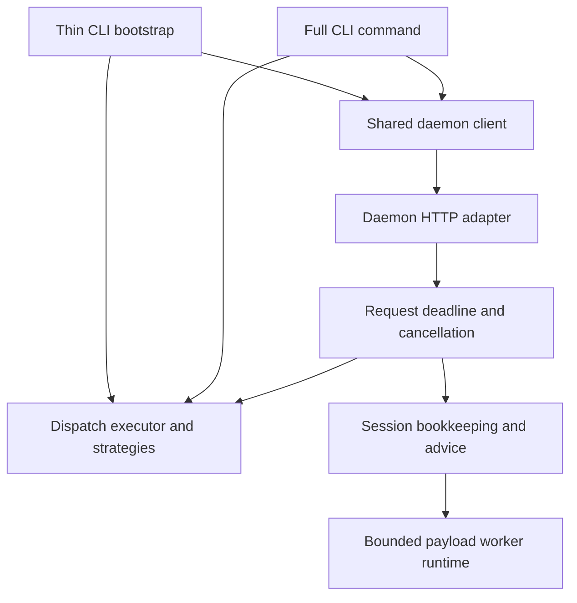

# Dispatcher and daemon boundaries

`executeDispatch()` returns the dispatch result and timing data. Strategies aggregate hook
results and validate their envelopes; they do not write to stdout. The CLI adapters emit the
agent response, while the daemon HTTP adapter returns it through `Response.json()`.

The thin bootstrap loads the full execution graph only for local fallback. Both CLI paths use
`dispatch/daemon-client.ts` for environment enrichment, transport, backoff and response-body
deadlines. A timeout is distinct from an unavailable daemon. Non-Stop events allow without a
second local execution after timeout; Stop and SubagentStop retain their local-check fallback.
Both leave response-writing headroom below the agent timeout. The Stop incomplete-task fast
path remains in the full CLI adapter, before transport.

`daemon/dispatch-session.ts` owns task lifecycle snapshots, session telemetry and repeated-advice
suppression. It has no HTTP dependency. `dispatch-request-scope.ts` applies one deadline across
body reading, preparation, execution and completion. It forwards cancellation into execution
and worker requests; late completion cannot revive active-dispatch entries or record a second
outcome. Providers that cannot cancel their I/O may still settle later, but cancellation is
checked before their results can start hooks or update session state.

`daemon/project-lifecycle.ts` owns project watcher registration, cache invalidation, eviction and
shutdown. Each registration has an abortable lifetime. Eviction cancels unfinished upstream
registration and disables callbacks from the old watcher lifetime. Reactivating the same project
creates a new lifetime, so an old completion cannot remove or recreate its replacement.

`DaemonWorkerRuntime` uses `PendingRequestRegistry` for capacity and deadlines. Each transport
generation owns its requests. A failed generation can be retired without affecting its
replacement. Capacity pressure falls back locally; caller cancellation and shutdown return no
result. The worker and local fallback share the pure `dispatch-payload.ts` normalizer.

Compatibility re-exports remain at the former module paths. Regression coverage lives beside
the client, executor, request scope, route adapter, project lifetime and worker runtime.
